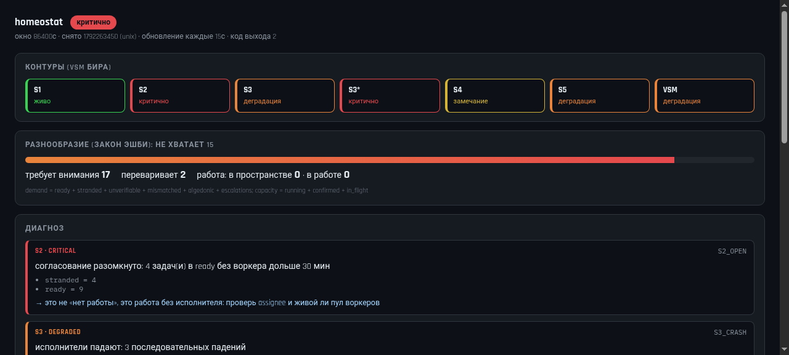

# homeostat

Прибор живучести команды агентов: показывает, **какой контур управления разомкнут**.
Не доска, не очередь, не планировщик — он ничего не выполняет и не хранит работу,
он читает следы пяти контуров и ставит диагноз.

Rust, две зависимости (`serde`, `serde_json`), без HTTP-клиента и без async: прибор читает
файлы и считает.

```bash
cargo test        # 21 тест
cargo run -- demo # три состояния: здоровая команда, разомкнутые контуры, перегрузка
```

## Зачем это

Модель — **VSM Стаффорда Бира**: у живучей системы пять функций, и все пять должны быть
замкнуты (S1 операции, S2 согласование, S3 управление «здесь и сейчас», S3\* аудит,
S4 разведка среды, S5 политика). Классический канбан показывает **столбцы**, но не
показывает, работает ли контур: карточка может стоять в `ready` три часа, и это выглядит
как «просто очередь».

Прибор отвечает на другой вопрос: *что в организации сломано и чем это подтверждается*.

Два закона, на которые он опирается:

* **Эшби, необходимое разнообразие**: «only variety can absorb variety». Если требует
  внимания больше, чем команда переваривает, это не «много работы», а несбалансированный
  контур. Прибор считает `demand` и `capacity` и называет разрыв числом.
* **POSIWID, Бир**: «the purpose of a system is what it does». Если аудит показывает
  расхождения в закрытиях, то назначение системы — выдавать неподтверждённые закрытия,
  что бы ни было написано в README.

Советский предшественник этой линии — «Тектология» Богданова (1913–1922) и ЦИТ/НОТ Гастева
(1920): организация труда как инженерия. С оговоркой, которую надо помнить: Гастев работал
с людьми как с «живой машиной», и в 1938-м его арестовали. Прибор описывает **организацию
работы**, а не людей.

## Как пользоваться

Прибор не запускает чужие команды: он читает то, что сняли вы.

```bash
# снять входы (одной строкой, любой планировщик)
hermes kanban list --json           > /tmp/kanban.json
hermes kanban diagnostics --json    > /tmp/diag.json
curl -s localhost:8801/stats        > /tmp/tupleboard.json

# диагноз
homeostat snapshot --kanban /tmp/kanban.json --diagnostics /tmp/diag.json \
                   --team data/team --tupleboard /tmp/tupleboard.json --window 3600
```

Код выхода: `0` всё живо (или только замечания), `1` деградация, `2` критично — годится для cron и CI.
`--json` — машинный отчёт. `homeostat watch --every 60 …` — одна строка в минуту.


## Панель (как доска у канбана)

```bash
homeostat serve --port 8901 --kanban /tmp/kanban.json --diagnostics /tmp/diag.json \
                --team data/team --window 3600
# → http://127.0.0.1:8901/  (страница пересобирает диагноз на каждый запрос)
```



Что на панели: вердикт и код выхода, полоса контуров S1–S5 + VSM (цвет — худший диагноз
в контуре), шкала разнообразия с числами `demand`/`capacity`, карточки диагнозов с
доказательствами и советом, таблица входов (`ok` / `НЕТ` / «не подключён»).

Панель **только читает**: она ничего не запускает и не меняет, поэтому её можно держать
открытой в фоне и смотреть на неё глазами, а не парсить JSON. `GET /report.json` отдаёт
тот же отчёт машине. Страница обновляется раз в 15 секунд.

## Что прибор говорит (реальный прогон на нашей команде)

```
вердикт: critical (код 2), окно 86400с
разнообразие: требует внимания 17, переваривает 2 — не хватает 15

контур степень   диагноз
S2     critical  согласование разомкнуто: 4 задач(и) в ready без воркера дольше 30 мин
       · stranded = 4
       · ready = 9
       → это не «нет работы», это работа без исполнителя: проверь assignee и живой ли пул воркеров
S3     degraded  исполнители падают: 3 последовательных падений
       → падение — это сигнал о среде (диск, память, доступы), а не о дисциплине
S3*    critical  закрытия не подтверждаются: 1 из 2 доказательств не воспроизводятся
       → POSIWID: система делает то, что показывает аудит, а не то, что заявлено
S4     note      разведка среды молчит: за окно ни одного внешнего изменения
S5     degraded  аварийный канал на пределе: 3 сигналов при лимите 3
VSM    degraded  разнообразие не уравновешено: требует внимания 17, команда переваривает 2
```

Это не синтетика: данные сняты с живого канбана и журналов командного слоя `tupleboard`.

## Входы и что из них берётся

| вход | откуда | что даёт |
|---|---|---|
| `--kanban` | `hermes kanban list --json` | running / ready / blocked / review, сколько разных исполнителей реально работает |
| `--diagnostics` | `hermes kanban diagnostics --json` | залипшие карточки (`stranded_in_ready`), повторные падения |
| `--team` | журналы `tupleboard` | закрытия и их вердикты, эскалации, алгедоника, лимит из политики |
| `--tupleboard` | `GET /stats` | что взято в работу, отказы по ёмкости |
| `--outlook` | jsonl внешних изменений | были ли сигналы из среды (S4) |

Правило прибора: **пропавший вход — это диагноз `INPUT_MISSING`, а не ноль**. Молчаливый ноль —
главный способ соврать в мониторинге.

## Диагнозы

| код | контур | когда |
|---|---|---|
| `INPUT_MISSING` | VSM | вход указан, но не прочитан |
| `S1_QUIET` | S1 | нет ни работающих задач, ни взятого в работу |
| `S2_OPEN` | S2 | карточки в `ready` без воркера дольше 30 мин |
| `S3_OPEN` | S3 | очередь не пуста, но никто не исполняет |
| `S3_CRASH` | S3 | повторные падения исполнителей |
| `S3STAR_QUIET` | S3\* | за окно ни одного перепроверенного закрытия |
| `S3STAR_MISMATCH` | S3\* | доказательства не воспроизводятся |
| `S3STAR_BLIND` | S3\* | доказательства не удалось проверить |
| `S4_QUIET` | S4 | ни одного внешнего изменения за окно |
| `S5_ALGEDONIC_SATURATED` | S5 | аварийный канал на лимите |
| `S5_WAITING` | S5 | владельцу ждут ответа вопросы |
| `VARIETY_SHORT` | VSM | `capacity < demand` с числами |

## Ограничения (честно)

* **`demand`/`capacity` — индикатор, а не закон.** Эшби сам писал, что разнообразие зависит
  от наблюдателя и его различений; наша шкала выбрана, а не выведена.
* Порог «залипло» (30 мин) — константа, а не политика; меняется в коде.
* Прибор видит только то, что ему сняли: если cron не снимает входы, он честно скажет
  `INPUT_MISSING`, но сам их не добудет — намеренно, чтобы не выполнять чужие команды.
* Прибор не лечит. Он называет контур и числа; чинить — диспетчеру, воркерам и владельцу.
* `S4_QUIET` — самый слабый сигнал: «снаружи тихо» и «сканер умер» неразличимы без самого сканера.

## Провенанс

* музей потерянных идей (только чтение): записи `linda` (аренды и разделяемая память) и дайджест
  [`rfc-graveyard`](https://kostyk348.github.io/lost-tech-museum/digests/rfc-graveyard/);
* соседний слой: [`tupleboard`](https://github.com/kostyk348/tupleboard) — пространство кортежей
  с арендами, договор на работу и аудит доказательств; организационная часть —
  в его `docs/TEAM-CYBERNETICS.md`;
* лицензия MIT.
